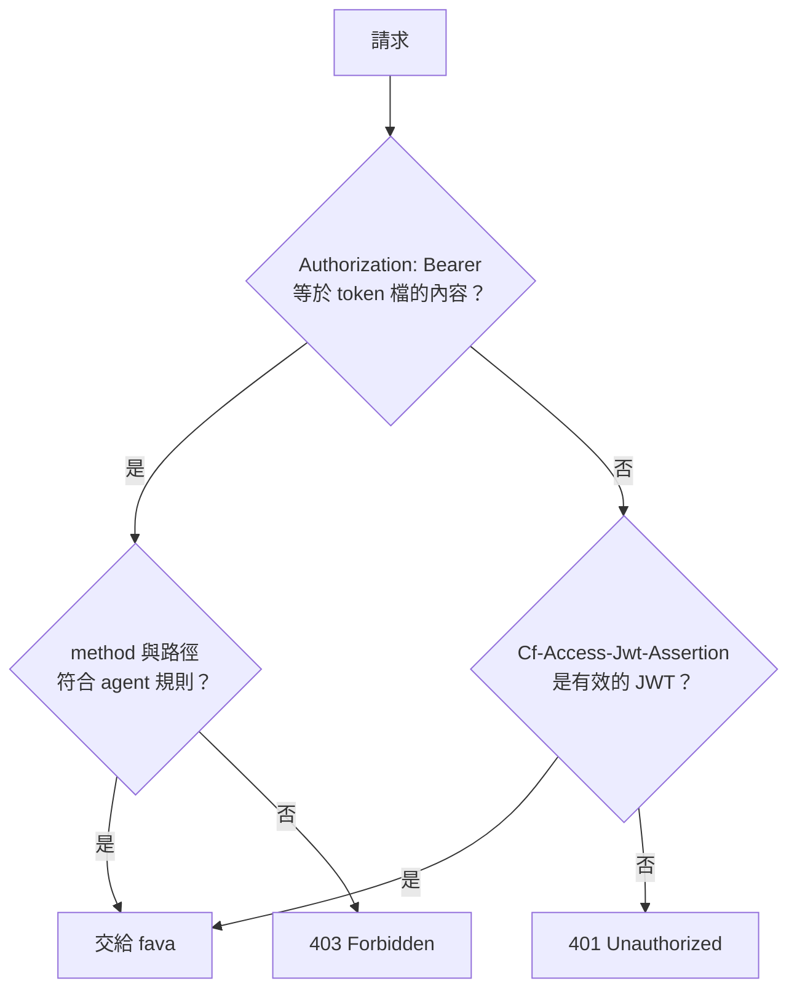
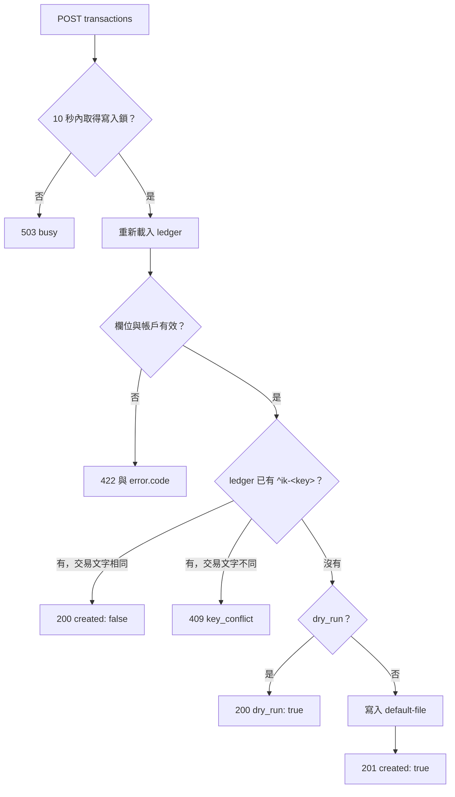
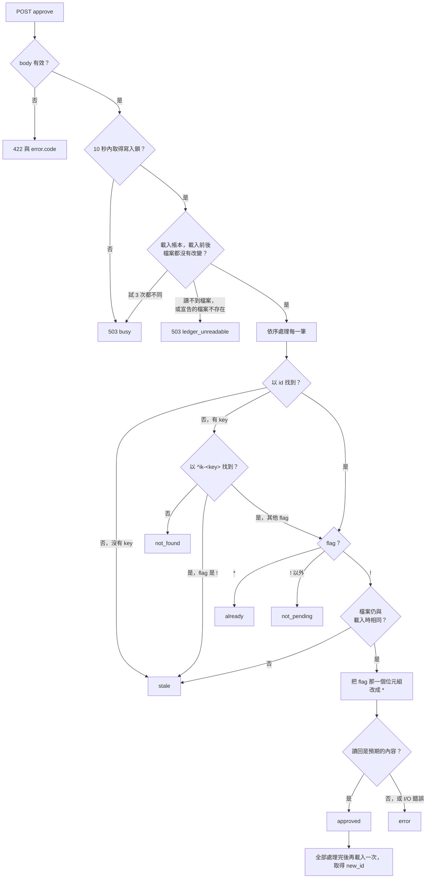

# agent API 參考

本文列出 guard 的規則、agent 可以呼叫的端點、欄位與回應碼。架構與部署步驟見 [agent-api.md](agent-api.md)。

下文的 `<bfile>` 是 ledger 的 URL slug，例如 `beancount`。

## 環境變數

fava container 讀取這些變數。

| 變數 | 值 | 說明 |
|---|---|---|
| `BEANCOUNT_FILE` | `/ledger/main.beancount` | ledger 主檔的絕對路徑。多個檔以 `:` 分隔。 |
| `AGENT_API_TOKEN_FILE` | `/run/secrets/agent-token` | agent token 檔的路徑。檔案讀不到或是空的時，container 停止。 |
| `CF_ACCESS_TEAM_DOMAIN` | `https://<team>.cloudflareaccess.com` | JWT 的 `iss` 必須等於這個值。公鑰從 `<值>/cdn-cgi/access/certs` 取得。 |
| `CF_ACCESS_AUD` | `<aud-tag>` | JWT 的 `aud` 必須等於這個值。 |
| `FAVA_HOST` | `0.0.0.0` | fava 監聽的位址。image 的預設值是 `0.0.0.0`，port 固定是 5000。 |

至少要設定 `AGENT_API_TOKEN_FILE`，或同時設定兩個 `CF_ACCESS_*` 變數。只設定一個 `CF_ACCESS_*` 變數時，container 停止。

Agent 這一端讀取 `BEANCOUNT_AGENT_TOKEN`（token 的值）與 `BEANCOUNT_FAVA_URL`（例如 `http://192.168.2.11:5656/beancount`）。

## 憑證與路徑規則

guard 對每個請求依這個順序判斷。



有效的 JWT 符合這些條件。fava 不讀 `CF_Authorization` cookie。

- 簽章是 RS256，`kid` 是 team 公鑰中的一把。
- `aud` 等於 `CF_ACCESS_AUD`，`iss` 等於 `CF_ACCESS_TEAM_DOMAIN`。
- `exp` 還沒到。

| 身分 | method | 路徑 | 結果 |
|---|---|---|---|
| 瀏覽器 | 全部 | 全部 | 交給 fava |
| agent | `GET` | `/<bfile>/api/<endpoint>` | 交給 fava |
| agent | `POST` | `/<bfile>/extension/AgentApi/<endpoint>` | 交給 extension |
| agent | 全部 | `/<bfile>/extension/AgentApi/mcp` | 交給 extension |
| agent | 其他 | 其他 | `403 Forbidden` |

`<endpoint>` 是一段路徑，不含 `/`。401 的 header 有 `WWW-Authenticate: Bearer realm="fava"`。401 與 403 的 body 是純文字的狀態列。

## fava 的 GET 端點

fava 1.30.16 的 GET 端點都開放給 agent：`account_report`、`balance_sheet`、`changed`、`commodities`、`context`、`documents`、`errors`、`events`、`extract`、`help`、`imports`、`income_statement`、`journal`、`journal_page`、`ledger_data`、`narration_transaction`、`narrations`、`options`、`payee_accounts`、`payee_transaction`、`query`、`source`、`source_slice`、`statistics`、`trial_balance`。

`GET /api/source` 回傳 ledger 檔的全文，所以持有 token 的人可以讀整本帳。Skill 只用 `ledger_data` 與 `query`。

| 用途 | 請求 | 回應中要讀的欄位 |
|---|---|---|
| 讀帳戶 | `GET /<bfile>/api/ledger_data` | `data.accounts` 是帳戶全名。`data.account_details["<帳戶>"].meta["name-zh"]` 是中文別名。 |
| 查交易 | `GET /<bfile>/api/query?query_string=<BQL>` | `data.rows` 與 `data.types`。 |
| 查帳本錯誤 | `GET /<bfile>/api/errors` | `data` 是錯誤清單。 |

fava 的 PUT 與 DELETE 端點對 agent 回 403：`PUT` 的 `add_document`、`add_entries`、`attach_document`、`format_source`、`move`、`source`、`source_slice`、`upload_import_file`，以及 `DELETE` 的 `document`、`source_slice`。

## `POST /<bfile>/extension/AgentApi/transactions`

新增一筆交易。錢從 `source` 流到 `target`；一張收據要拆成多個費用時，改用 `targets` 列出每個帳戶與金額。body 是 JSON 物件，`Content-Type` 是 `application/json`。

### 欄位

| 欄位 | 必填 | 型別 | 規則 |
|---|---|---|---|
| `source` | 是 | string | 錢流出的帳戶。可以是帳戶全名、完整的 `name-zh`，或 `name-zh` 以 `/` 分段的最後一段。 |
| `target` | `target` 加 `amount`，與 `targets` 擇一 | string | 錢流入的帳戶。格式同 `source`。 |
| `amount` | `target` 加 `amount`，與 `targets` 擇一 | string | `[0-9]{1,15}(\.[0-9]{1,2})?`，大於 0。 |
| `targets` | `target` 加 `amount`，與 `targets` 擇一 | 物件陣列 | 1 到 20 筆，每筆是 `{"account", "amount"}`，兩個欄位都必填，不接受其他欄位。`account` 的格式同 `source`，必須是費用帳戶（根名稱等於 `option "name_expenses"`，預設 `Expenses`），`amount` 的規則同 `amount`。同一個帳戶只能出現一次。 |
| `key` | 是 | string | `[A-Za-z0-9\-_/.]+`。寫成 link `^ik-<key>`。 |
| `date` | `date` 與 `time` 擇一 | string | `YYYY-MM-DD`。 |
| `time` | `date` 與 `time` 擇一 | string | RFC 3339，要有時區，例如 `2026-09-25T07:00:00+08:00`。fava 換算成 `Asia/Taipei` 的日期，並加上 metadata `time: "07:00:00"`。 |
| `currency` | 否 | string | 預設是第一個 `operating_currency`。`source` 與每個 `target` 都必須接受這個幣別。 |
| `narration` | 否 | string | 說明，例如品名。預設是空字串。不能有 Unicode 類別 `Cc`、`Cs`、`Zl`、`Zp` 的字元。 |
| `payee` | 否 | string | 交易對象，例如店家或代墊人。規則同 `narration`。空字串等於沒有 payee。 |
| `tags` | 否 | string 陣列 | 每個 tag 只能用 `[A-Za-z0-9\-_/.]`，不含 `#`。重複的 tag 只寫一次。beancount 不接受中文 tag。 |
| `meta` | 否 | 物件，值是 string | 交易的 metadata，例如 `{"note": "還代墊"}`。key 是 `[a-z][a-zA-Z0-9\-_]*`。`time`、`filename`、`lineno` 是保留的 key。值的規則同 `narration`。 |
| `dry_run` | 否 | boolean | `true` 時回傳交易文字，不寫入。 |

其他規則：

- 不接受上表以外的欄位。`links` 不開放，`^ik-<key>` 是唯一的 link。
- 日期不能晚於 `Asia/Taipei` 的今天加 366 天。
- 帳戶在該日期必須是開啟的。開帳日不能晚於該日期。帳戶有關帳日時，關帳日不能早於該日期。
- `source` 與 `target`（或 `targets` 中的任何帳戶）不能是同一個帳戶。
- `targets` 中的帳戶以別名解析後不能重複，例如「晚餐」與 `Expenses:Food:Dinner` 算同一個。
- `targets` 只接受費用帳戶，所以拆分的每一筆都會出現在 `POST spending`。要記到其他帳戶（例如轉帳到資產帳戶）時，用單一的 `target`，它不限帳戶種類。

### 寫入的交易

交易一律是 `!` flag。`target` 是正數，`source` 是負數。用 `targets` 時，費用 posting 依請求的順序排列，最後是 `source`，金額是所有 `targets` 的加總取負號；不另外傳總額。tag 依字母排序。metadata 依 key 排序，包含 `time`。

以測試用的 ledger 為例，「錢包」是 `Assets:TW:Cash`，「晚餐」是 `Expenses:Food:Dinner`。

請求：

```json
{
  "date": "2026-09-24",
  "source": "錢包",
  "target": "晚餐",
  "amount": "190",
  "payee": "小明",
  "narration": "手機",
  "tags": ["reimburse", "family"],
  "meta": {"via": "line-pay", "note": "還代墊"},
  "key": "r1"
}
```

寫入的交易：

```beancount
2026-09-24 ! "小明" "手機" #family #reimburse ^ik-r1
  note: "還代墊"
  via: "line-pay"
  Expenses:Food:Dinner                                  190 TWD
  Assets:TW:Cash                                       -190 TWD
```

以 `"tags": ["family", "reimburse", "family"]` 與 `"meta": {"note": "還代墊", "via": "line-pay"}` 重送同一個 key，回 200 與同一筆交易。只送 `"tags": ["reimburse"]` 則回 409。

拆成多個費用的請求，「公務/午餐」是 `Expenses:Work:Lunch`：

```json
{
  "date": "2026-09-24",
  "source": "錢包",
  "targets": [
    {"account": "晚餐", "amount": "190"},
    {"account": "公務/午餐", "amount": "80.5"}
  ],
  "narration": "收據",
  "key": "s1"
}
```

寫入的交易：

```beancount
2026-09-24 ! "收據" ^ik-s1
  Expenses:Food:Dinner                                  190 TWD
  Expenses:Work:Lunch                                  80.5 TWD
  Assets:TW:Cash                                     -270.5 TWD
```

### 處理順序與冪等



比較交易文字時不比較 flag，所以已核准成 `*` 的交易也算相同。tag 與 metadata 已排序，所以重送時欄位的順序不影響結果。`targets` 不排序：以同一個 key 重送時，`targets` 的順序不同就是不同的交易，回 409。

使用者在 fava 核准時如果同時修改了交易（例如 narration、tag 或 metadata），之後以同一個 key 重送會得到 409。

fava 寫入前不檢查整本帳。201 的 `errors` 是寫入前後 fava 的錯誤數量，兩者不同時要檢查帳本。

### 回應

| 狀態 | body | 意思 |
|---|---|---|
| 201 | `{"created": true, "link", "entry", "errors": {"before", "after"}}` | 已寫入。`entry` 是交易文字。 |
| 200 | `{"created": false, "link", "entry"}` | 同一個 key 已有相同的交易，沒有寫入。 |
| 200 | `{"created": false, "dry_run": true, "link", "entry"}` | 預覽，沒有寫入。 |
| 409 | `{"error": {...}, "entry"}` | `code` 是 `key_conflict`。這個 key 已用在另一筆交易。`entry` 是既有交易的文字。 |
| 422 | `{"error": {...}}` | 請求不符合規則。`code` 見下表。 |
| 503 | `{"error": {...}}` | `code` 是 `busy`。另一筆寫入還沒完成。以同一個 key 重送。 |
| 401 | `401 Unauthorized` | 沒有憑證或憑證無效。 |
| 403 | `403 Forbidden` | 這個身分不能用這個 method 或路徑。 |

`error` 物件一律有 `field`、`code`、`message`、`candidates` 四個欄位。`candidates` 只在 `ambiguous_account` 時有內容。`message` 說明怎麼修正。

| 422 的 `code` | `field` | 原因 |
|---|---|---|
| `invalid_body` | 空字串 | body 不是 JSON 物件。 |
| `unknown_field` | 該欄位，例如 `targets[0].note` | 不接受的欄位。 |
| `invalid_type` | 該欄位，例如 `targets[0]`、`targets[1].amount` | 型別錯誤。`dry_run` 要是 boolean，`tags` 要是 string 陣列，`meta` 要是值為 string 的物件，`targets` 要是物件陣列，其他要是 string。 |
| `missing` | 該欄位，例如 `target`、`targets[0].amount` | 缺少必填欄位、`targets` 是空陣列，或 ledger 沒有 `operating_currency` 且請求沒有 `currency`。`target`、`amount` 與 `targets` 都沒送時，`field` 是 `target`。 |
| `target_or_targets` | `target` 或 `amount` | 同時送了 `targets` 與 `target` 或 `amount`。 |
| `too_many` | `targets` | 超過 20 筆。 |
| `invalid_key` | `key` | key 有不允許的字元。 |
| `date_or_time` | `date` | `date` 與 `time` 都有或都沒有。 |
| `invalid_date` | `date` | 不是 `YYYY-MM-DD` 或不是有效日期。 |
| `invalid_time` | `time` | 不是帶時區的 RFC 3339。 |
| `date_out_of_range` | `date` 或 `time` | 日期晚於今天加 366 天。 |
| `invalid_amount` | `amount` 或 `targets[<n>].amount` | 格式錯誤、超過兩位小數或不大於 0。 |
| `invalid_currency` | `currency` | 不是幣別代碼。 |
| `invalid_narration` | `narration` | 有換行或控制字元。 |
| `invalid_payee` | `payee` | 有換行或控制字元。 |
| `invalid_tag` | `tags` | tag 是空字串，或有 `[A-Za-z0-9\-_/.]` 以外的字元。 |
| `invalid_meta_key` | `meta` | key 不符合 `[a-z][a-zA-Z0-9\-_]*`。 |
| `reserved_meta_key` | `meta` | key 是 `time`、`filename` 或 `lineno`。 |
| `invalid_meta_value` | `meta` | 值有換行或控制字元。 |
| `invalid_account_name` | `source`、`target` 或 `targets[<n>].account` | 不是別名，也不是有效的帳戶名稱。 |
| `unknown_account` | `source`、`target` 或 `targets[<n>].account` | 帳戶名稱有效，但 ledger 沒有開這個帳戶。 |
| `ambiguous_account` | `source`、`target` 或 `targets[<n>].account` | 別名符合多個帳戶，`candidates` 列出它們。 |
| `account_not_open` | `source`、`target` 或 `targets[<n>].account` | 日期早於開帳日。 |
| `account_closed` | `source`、`target` 或 `targets[<n>].account` | 日期晚於關帳日。 |
| `same_account` | `target` 或 `targets[<n>].account` | 與 `source` 是同一個帳戶。 |
| `duplicate_account` | `targets[<n>].account` | 這個帳戶已在前面的 `targets` 出現過。 |
| `not_expense_account` | `targets[<n>].account` | 帳戶的根名稱不是 `option "name_expenses"`。 |
| `currency_not_allowed` | `currency` | 帳戶不接受這個幣別。 |

## `POST /<bfile>/extension/AgentApi/spending`

讀一天的交易與那天所在月份的費用合計，包含待核准（`!`）與已核准（`*`）的交易。這個端點只讀不寫。body 是 JSON 物件，`Content-Type` 是 `application/json`。

| 欄位 | 必填 | 型別 | 規則 |
|---|---|---|---|
| `date` | 是 | string | `YYYY-MM-DD`。不接受其他欄位。 |

請求 `{"date": "2026-10-05"}` 的回應如下，`transactions` 只列出第一筆：

```json
{
  "date": "2026-10-05",
  "transactions": [
    {
      "id": "0f9bf9862a2867de7a7034abe8b01cd3",
      "date": "2026-10-05", "flag": "!",
      "payee": "全聯", "narration": "採買與晚餐",
      "key": "web-123",
      "expenses": [
        {"account": "Expenses:Daily:Groceries", "name_zh": "日用/雜貨", "number": "300", "currency": "TWD"},
        {"account": "Expenses:Food:Dinner", "name_zh": "食物/晚餐", "number": "150", "currency": "TWD"}
      ],
      "funding": [
        {"account": "Liabilities:Card:Cathay", "name_zh": "國泰卡", "number": "-450", "currency": "TWD"}
      ]
    }
  ],
  "month": {
    "month": "2026-10",
    "total":   [{"currency": "TWD", "number": "680"}, {"currency": "USD", "number": "30.50"}],
    "pending": [{"currency": "TWD", "number": "450"}, {"currency": "USD", "number": "10.50"}]
  },
  "ledger_errors": 0
}
```

| 欄位 | 說明 |
|---|---|
| `transactions` | 那天有費用 posting 的交易，依帳本順序。只在資產與負債之間轉帳的交易不列出。費用帳戶是根名稱等於 `option "name_expenses"`（預設 `Expenses`）的帳戶。 |
| `id` | fava 的 entry hash，可以傳給 `GET /<bfile>/api/source_slice?entry_hash=<id>`。只代表這個版本：交易的任何文字改變（包含核准時 flag 從 `!` 改成 `*`），或交易所在的檔名或行號改變（例如同一檔案中它前面多了一行）後，`id` 也會改變。跨次對應同一筆交易用 `key`。 |
| `payee` | 沒有 payee 時是 `null`。 |
| `key` | link `^ik-<key>` 去掉 `ik-` 的部分。沒有這種 link 時是 `null`。交易有多個 `^ik-` link 時（例如在 fava 手動加上），取去掉 `ik-` 後依字母排序最前的一個，其他的不回傳。所以 `key` 不一定是當初新增這筆交易時送出的 key，也不代表交易全部的 link。`POST transactions` 只寫入一個 `^ik-` link。 |
| `expenses` | 費用 posting，依帳本順序。 |
| `funding` | 其餘 posting，依帳本順序。 |
| `name_zh` | 帳戶 `open` 的 `name-zh` metadata。沒有時是 `null`。 |
| `number` | Decimal 字串，不用指數表示，例如 `"-337.050"`。以 posting 的單位幣別計，有 `@` 價格也不換算。 |
| `month.total` | 當月每種幣別的費用淨額，包含所有 flag。退款以負數抵減。依幣別字母排序。 |
| `month.pending` | 同 `total`，但只算 `!` 的交易。 |
| `ledger_errors` | fava 的帳本錯誤數量。帳本有語法錯誤時，出錯的交易不會出現在回應中，所以 `ledger_errors` 大於 0 時合計可能不完整。 |

fava 在處理 extension 的請求之前會檢查 ledger 檔有沒有改變，改了就重新載入。所以從 fava 網頁核准、經由 `POST transactions` 寫入、或直接改檔之後，不必先呼叫 `/api/changed`。

這個端點會檢查變更，但不等其他請求的重載完成。另一個請求正在重新載入時，這次讀取回 200 與重新載入前的資料；重新載入完成後，下一次讀取會是新資料。fava 先記下「這次變更已有人處理」，再載入檔案，兩步之間沒有鎖，所以同時進來的請求不會再載入一次。daemon 與網頁要靠下一次讀取更新，例如寫入或核准後重新讀取，或定期重新讀取。

這個端點不經過 fava 的 BQL shell，所以不受其他請求的篩選條件影響。

| 狀態 | 意思 |
|---|---|
| 200 | 回傳上面的 body。 |
| 422 | 請求不符合規則。`error` 的格式同 `POST transactions`，`code` 見下表。 |
| 403 | agent 用 `POST` 以外的 method。 |

| 422 的 `code` | `field` | 原因 |
|---|---|---|
| `invalid_body` | 空字串 | body 不是 JSON 物件。 |
| `unknown_field` | 該欄位 | 有 `date` 以外的欄位。 |
| `missing` | `date` | 缺少 `date`。 |
| `invalid_date` | `date` | 不是 `YYYY-MM-DD` 格式的有效日期，或那個月的下一個月超出日期範圍（`9999-12`）。 |

## `POST /<bfile>/extension/AgentApi/approve`

把待核准（`!`）的交易核准成 `*`。只改交易首行的 flag 這一個字元，金額、帳戶、日期、payee、narration、metadata 與縮排都不變。沒有 `^ik-` link 的交易（例如在 fava 或編輯器手寫的）也可以核准。body 是 JSON 物件，`Content-Type` 是 `application/json`。

這個端點只給 tars 的 daemon 在使用者按下核准時呼叫。MCP 沒有對應的 tool。

| 欄位 | 必填 | 型別 | 規則 |
|---|---|---|---|
| `items` | 是 | 陣列 | 最多 50 筆。不接受其他欄位。 |
| `items[].id` | 是 | string | `POST spending` 回應中那筆交易的 `id`，代表使用者看到的版本。 |
| `items[].key` | 否 | string 或 `null` | 那筆交易的 `key`。`id` 已找不到時，改用 `^ik-<key>` 找那筆交易，讓重送有相同結果。 |

請求：

```json
{"items": [{"id": "d362d2af421e7328385e5f90dc63e49a", "key": "web-123"}, {"id": "77aa0000000000000000000000000000"}]}
```

回應：

```json
{"results": [
  {"id": "d362d2af421e7328385e5f90dc63e49a", "key": "web-123", "result": "approved", "new_id": "b529ca49a1c3aab4a1cb65c3b7c0225a"},
  {"id": "77aa0000000000000000000000000000", "key": null, "result": "stale"}
], "ledger_errors": 0, "reload_error": null}
```

`results` 的順序與請求相同，每筆帶回請求的 `id` 與 `key`。一筆失敗不影響其他筆。

| `result` | 意思 |
|---|---|
| `approved` | 已從 `!` 改成 `*`，並已讀回確認。`new_id` 是核准後的 `id`，取自寫入後再載入一次的帳本，所以 plugin 依 flag 改變的資料也算在內。那次載入對不上這次寫入的內容時（例如檔案在寫入後又被改過），`new_id` 是 `null`，重新讀取 `POST spending` 取得 `id`。 |
| `already` | 那筆交易已是 `*`：以 `id` 找到的交易已是 `*`，或 `id` 找不到但以 `key` 找到的交易已是 `*`。 |
| `stale` | 帳本上沒有使用者看到的那個版本，沒有寫入。可能是 `id` 找不到又沒有 `key`、以 `key` 找到的交易仍是 `!` 但內容或位置已改變，或檔案在核准讀取之後、寫入之前被改過。重新讀取 `POST spending`，再讓使用者決定。 |
| `not_found` | `id` 找不到，以 `key` 也找不到交易。 |
| `not_pending` | 找到了，但 flag 不是 `!` 也不是 `*`。 |
| `error` | 結果未知：寫入或讀回時發生 I/O 錯誤，或讀回的內容不是預期的內容。那筆可能已核准，也可能沒有。`message` 寫出檔案與位元組位置。重新讀取 `POST spending`，並在 fava 檢查那個檔案。 |

`error` 的 `message` 範例：

```text
/ledger/txns.beancount at byte 1234 did not read back as approved: another program wrote the file while the flag was written. That byte may now be a stray * in the other program's text, and it is not restored; check the file in fava.
```

讀回不符表示另一個程式剛好在寫入的瞬間存了檔。若它是原地存檔，`*` 會寫進它的新內容中同一個位元組位置，取代原本的字元。這個位元組不會自動復原，要在 fava 打開那個檔案，檢查那個位置。

### 處理順序



核准不使用 fava 記憶體中的帳本，因為另一個請求正在重新載入時，那份帳本可能還是舊的（見 `POST spending`）。核准在寫入鎖內自己載入一次帳本，並在載入前後各讀一次所有檔案的位元組，以及 inode、大小、mtime 與 ctime。兩次全部相同，這次載入的交易才對應到磁碟上的內容；否則重試，最多 3 次。

只比位元組不夠。檔案可能在載入期間被改掉又改回原樣，前後讀到的位元組相同，載入的卻是中間那個版本。每次寫入都會更新 ctime，所以加上 stat 的比對就能發現這種情況，前提是檔案系統的時間戳記分辨得出這兩次寫入。本機 Linux 7.2 的 tmpfs 與 btrfs 實測 2000 次都分辨得出；Unraid 的 shfs 與 SMB 掛載沒有實測。

`id` 是 fava 的 entry hash，涵蓋交易的全部內容，包含 metadata、tag、link、cost、price、檔名與行號。只有使用者看到的那個版本會符合。內容改過，或同一位置換成了另一筆相似的交易，都回 `stale`。

寫入時只改 flag 那一個位元組。檔案的其他位元組都不變，包括換行字元（LF 或 CRLF）與檔尾有沒有換行。檔案的 inode、擁有者與權限也不變。寫入後再以路徑讀回整個檔案，確認只有那一個位元組改變。全部處理完後，核准自己再載入一次帳本，取得每一筆核准後的 `new_id`，再重新載入 fava 的 ledger。所以有寫入的請求會完整載入帳本三次：核准前一次、取得 `new_id` 一次、fava 重新載入一次。帳本越大越久，這段時間其他新增與核准要等寫入鎖。

### 與其他寫入者的同步

| 寫入者 | 保證 |
|---|---|
| 同一個 fava process 內的寫入：`POST approve`、`POST transactions`、fava 網頁的編輯與存檔 | 彼此不會覆蓋。前兩者共用 API 的寫入鎖，寫入時另外持有 fava 自己的檔案鎖。 |
| 外部編輯器在核准讀取檔案之前存的內容 | 都會保留。核准發現檔案與載入時不同，就回 `stale`，不寫入。 |
| 外部編輯器在核准載入期間改檔，又改回原樣 | 回 `stale`，不寫入。前提是檔案系統的時間戳記分辨得出這兩次寫入，見上文。 |
| 外部編輯器剛好在核准寫入的瞬間存檔 | 核准可能把 `*` 寫到錯的位置，或核准遺失。這種情況回 `error`，不回 `approved`。網頁要重新讀取，並請使用者在 fava 檢查那個檔案。 |

外部編輯器不使用任何鎖，所以沒有方法完全排除最後一種情況。不要在核准的同時，用外部編輯器編輯同一個檔案。

### 回應

| 狀態 | body | 意思 |
|---|---|---|
| 200 | `{"results", "ledger_errors", "reload_error"}` | 每一筆的結果。`ledger_errors` 是處理完後 fava 的帳本錯誤數量。`reload_error` 平時是 `null`。處理完後 fava 重新載入失敗時，`reload_error` 是說明文字，`ledger_errors` 是 `null`；`results` 仍是實際結果，已寫入的筆照樣回 `approved`。這時 fava 可能繼續顯示這次請求之前的帳本，直到帳本檔案再次變更或 fava 重新啟動。 |
| 422 | `{"error": {...}}` | 請求不符合規則。`error` 的格式同 `POST transactions`，`code` 見下表。 |
| 503 | `{"error": {...}}` | 一筆都沒有處理。`code` 是 `busy` 時，另一筆寫入還沒完成，或載入帳本時檔案一直在改變，以同樣的 body 重送。`code` 是 `ledger_unreadable` 時，讀不到某個帳本檔案，`message` 寫出是哪個檔案或哪個 `include`；網頁可以顯示「帳本讀不到」，修好檔案後再重送。讀不到包括：沒有讀取權限、主檔不存在、主檔仍有 `include` 宣告但檔案不存在（也包括 glob 沒有對應任何檔案）。已從主檔移除 `include` 宣告的檔案不算，核准照新的帳本處理。 |

| 422 的 `code` | `field` | 原因 |
|---|---|---|
| `invalid_body` | 空字串 | body 不是 JSON 物件。 |
| `unknown_field` | 該欄位，例如 `items[0].flag` | 不接受的欄位。 |
| `missing` | `items` 或 `items[<n>].id` | 缺少必填欄位。 |
| `invalid_type` | 該欄位，例如 `items[0]` | `items` 不是陣列、項目不是物件、`id` 不是 string，或 `key` 不是 string 也不是 `null`。 |
| `too_many` | `items` | 超過 50 筆。 |

## MCP 端點 `/<bfile>/extension/AgentApi/mcp`

### 協定

- 只支援 MCP `2026-07-28`。每個請求獨立處理，回應一律是 JSON，沒有 SSE。
- 支援的方法：`server/discover`、`tools/list`、`tools/call`。
- notification（沒有 `id`）回 202，沒有 body。
- 其他方法（包含 `initialize`、`ping`、`resources/list`）回 HTTP 404 與 `-32601`。
- 每個請求都要有 `MCP-Protocol-Version` 與 `Mcp-Method` header。`tools/call` 另要 `Mcp-Name`。header 與 body 不符時回 400 與 `-32020`。
- `params._meta` 必須有 `io.modelcontextprotocol/protocolVersion` 與 `io.modelcontextprotocol/clientCapabilities`。缺少時回 400 與 `-32602`。
- 版本不是 `2026-07-28` 時回 400 與 `-32022`，`data.supported` 是 `["2026-07-28"]`。
- body 不是單一 JSON 物件（例如 batch 陣列）時回 400 與 `-32600`。body 不是 JSON 時回 400 與 `-32700`。
- 請求有 `Origin` header 時回 403 與 `-32600`。
- `GET`、`PUT`、`DELETE` 回 405，header 有 `Allow: POST`。
- 每個結果都有 `resultType: "complete"`。`server/discover` 與 `tools/list` 另有 `ttlMs: 3600000` 與 `cacheScope: "private"`。
- 每個請求在 container 的 stderr 寫一行 `mcp <method> <tool> <HTTP 狀態> [附註]`，例如 `mcp tools/call add_transaction 200`。

### tool

| tool | 參數 | 結果 |
|---|---|---|
| `list_accounts` | 無 | 與 `GET /<bfile>/api/ledger_data` 的 body 相同。 |
| `query` | `query_string`（BQL，必填） | 與 `GET /<bfile>/api/query` 的 body 相同，但沒有 fava 的篩選條件。 |
| `add_transaction` | 與 `POST transactions` 的欄位相同，包含 `payee`、`tags`、`meta`、`targets`。`inputSchema` 的 `required` 只有 `source` 與 `key`，`target` 加 `amount` 與 `targets` 擇一寫在說明中。 | 與 `POST transactions` 的 body 相同。 |

`tools/call` 的結果有三個欄位。

- `content`：一個 text，內容是 body 的 JSON 文字。
- `structuredContent`：同一個 body。
- `isError`：body 對應的 HTTP 狀態是 400 以上時為 `true`，例如 422 的驗證錯誤。MCP 的 HTTP 狀態仍是 200。

未知的 tool 回 400 與 `-32602`。

### 範例

```http
POST /beancount/extension/AgentApi/mcp HTTP/1.1
Authorization: Bearer <token>
Content-Type: application/json
MCP-Protocol-Version: 2026-07-28
Mcp-Method: tools/call
Mcp-Name: add_transaction

{"jsonrpc": "2.0", "id": 1, "method": "tools/call",
 "params": {"name": "add_transaction",
            "arguments": {"date": "2026-09-24", "source": "錢包", "target": "晚餐",
                          "amount": "190", "narration": "晚餐", "key": "20260924-dinner-190"},
            "_meta": {"io.modelcontextprotocol/protocolVersion": "2026-07-28",
                      "io.modelcontextprotocol/clientCapabilities": {}}}}
```
